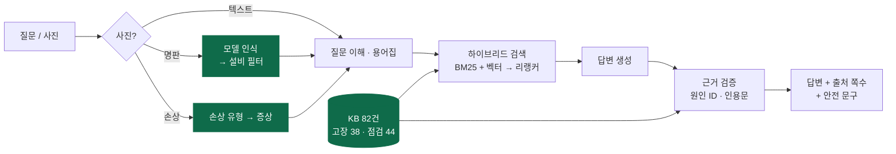

<div align="center">

# 🏭 Wanna Know — 컨베이어 매뉴얼 RAG 챗봇

<p>
  
</p>

**제조사 매뉴얼 PDF를 근거로, 컨베이어 장애의 원인·조치를 출처 쪽수와 함께 답하는 RAG 챗봇**

6인 팀 프로젝트 · 2026.10.22 ~ 11.02 · 이 저장소는 팀 저장소 [WannaKnowHD/wanna_know](https://github.com/WannaKnowHD/wanna_know)의 포크입니다.

[](https://www.youtube.com/watch?v=KxTcteps2Xo)
[](https://github.com/WannaKnowHD/wanna_know)

**저(김민재)는 지식베이스(KB) 설계·구축, 사진 입력(명판·손상), 평가 자동 채점을 맡았습니다.**


</div>

## 목차

[시연 영상](#시연-영상) · [프로젝트 한눈에 보기](#프로젝트-한눈에-보기) · [내가 맡은 부분](#내가-맡은-부분) · [주요 작업과 문제 해결](#주요-작업과-문제-해결) · [결과](#결과) · [실행 방법](#실행-방법) · [배운 점](#배운-점) · [팀](#팀)

## 시연 영상

<p align="center">
  <a href="https://www.youtube.com/watch?v=KxTcteps2Xo">
    
  </a>
  <br><sub>이미지를 누르면 YouTube에서 재생됩니다.</sub>
</p>

## 프로젝트 한눈에 보기

**문제.** 현장 엔지니어가 설비 장애를 해결하려면 영어로 된 제조사 매뉴얼에서 답을 찾아야 합니다. 그런데 답은 표와 그림 안에 있고, Fenner 매뉴얼처럼 증상 표에는 해결책 번호만 있고 실제 해결책은 다른 쪽에 흩어져 있기도 합니다.

**해결.** 매뉴얼의 트러블슈팅 표·점검표를 구조화된 지식베이스로 만들고, 하이브리드 검색으로 근거를 찾은 뒤, LLM이 만든 답이 실제 근거와 맞는지 코드로 다시 검증합니다. 매뉴얼에 없는 내용은 지어내지 않고 "확인되지 않음"으로 답합니다.



<sub>초록색이 제가 맡은 부분입니다. 평가 자동 채점(`eval/run_eval.py`)은 이 흐름 전체를 채점합니다.</sub>

## 내가 맡은 부분

| 영역 | 한 일 | 주요 파일 | PR |
| --- | --- | --- | --- |
| **KB 스키마** | 트러블슈팅·점검 KB 형식과 원인 ID 규칙(`kb_id#c1`) 설계, 실제 매뉴얼에 맞게 확장 | `chatbot/core/schemas.py` | [#27](https://github.com/WannaKnowHD/wanna_know/pull/27) [#29](https://github.com/WannaKnowHD/wanna_know/pull/29) |
| **KB 구축** | 매뉴얼 3종 → KB 82건 변환, 새 PDF의 표 자동 변환 | `chatbot/rag/document_processor.py` (KbBuilder), `scripts/build_kb.py`, `kb/` | [#70](https://github.com/WannaKnowHD/wanna_know/pull/70) |
| **KB 검증·병합** | 스키마·참조 검사, 여러 모델에 반복되는 같은 표를 1건으로 병합 | `validate_kb`, `merge_applies_to` | [#77](https://github.com/WannaKnowHD/wanna_know/pull/77) |
| **용어집·설비 목록** | 현장 표현 ↔ 매뉴얼 영문 용어 사전, 설비 모델 목록과 로더 | `data/glossary.csv`, `data/models.csv`, `chatbot/rag/glossary.py` | [#43](https://github.com/WannaKnowHD/wanna_know/pull/43) |
| **명판 인식** | 명판 사진에서 모델명 판독 → 표기 정규화 → 설비 목록과 매칭 | `chatbot/vision/vision.py` | [#86](https://github.com/WannaKnowHD/wanna_know/pull/86) |
| **손상 사진 분석** | 손상 유형 분류 → 증상·KB 후보 연결 | `vision.py`, `data/damage_map.csv` | [#91](https://github.com/WannaKnowHD/wanna_know/pull/91) |
| **사진 첨부 화면** | 사진 판별·재촬영 안내, 사진과 질문을 함께 보내면 둘 다 반영한 답변 | `chatbot/ui/gradio_app.py` (`on_image`) | [#98](https://github.com/WannaKnowHD/wanna_know/pull/98) [#158](https://github.com/WannaKnowHD/wanna_know/pull/158) [#161](https://github.com/WannaKnowHD/wanna_know/pull/161) |
| **평가 자동 채점** | 평가셋 100문항 자동 채점 (KB·원인·출처·모름 처리·사진) | `eval/run_eval.py` | [#121](https://github.com/WannaKnowHD/wanna_know/pull/121) [#177](https://github.com/WannaKnowHD/wanna_know/pull/177) |
| **프로젝트 뼈대** | 기능명세서 기준 폴더 구조와 클래스·메소드 뼈대, 명세서 일치 테스트 | `tests/test_spec_conformance.py` | `c96810b` [#4](https://github.com/WannaKnowHD/wanna_know/pull/4) |

## 주요 작업과 문제 해결

### 1. 목데이터로 만든 KB 스키마를 실제 매뉴얼에 맞추기

처음에는 연습용 가상 매뉴얼로 스키마를 정했는데, 실제 매뉴얼 3종을 넣어 보니 맞지 않는 부분이 나왔습니다.

| 실제 매뉴얼에서 발견한 것 | 스키마에 반영한 것 |
| --- | --- |
| 한 트러블슈팅 표가 그 매뉴얼의 모든 모델에 적용됨 | 모든 모델용 `applies_to: ["*"]` 추가 ([#27](https://github.com/WannaKnowHD/wanna_know/pull/27)) |
| 점검 주기가 "1,500~3,000시간"처럼 범위로 적힘 (PRECO) | `interval_hours_max` 추가 ([#29](https://github.com/WannaKnowHD/wanna_know/pull/29)) |
| 같은 표가 여러 모델 매뉴얼에 반복됨 | 같은 표는 1건으로 합치고 적용 모델을 모음 ([#77](https://github.com/WannaKnowHD/wanna_know/pull/77)) |

원인마다 `kb_id#c1` 형식의 ID를 붙여서, LLM 답변의 원인이 실제 매뉴얼에 있는지 **코드로 검증**하고, 평가에서도 정답 원인을 맞혔는지 **자동으로 채점**할 수 있게 했습니다.

### 2. 표 모양이 매뉴얼마다 다른 문제

매뉴얼마다 트러블슈팅 표의 구조가 달랐습니다. Hytrol과 PRECO는 "문제 · 원인 · 해결" 표지만, Fenner는 증상 A~X 옆에 해결책 **번호**만 있고, 번호 1~53의 해결책은 다른 쪽에 따로 있습니다.

- 초기 매뉴얼 3종은 `scripts/build_kb.py`로 구조별 규칙을 적용해 KB **82건(고장 38 · 점검 44)**을 만들었습니다.
- 관리자가 새 PDF를 올리면 `KbBuilder.from_sections`가 머리글로 표 형식을 알아보고(트러블슈팅 3칸 머리글, 주기 칸에 X 표시가 있는 점검표) 자동 변환합니다.
- 알아볼 수 없는 표는 **건너뛰고 표 청크로만 검색**되게 해서, 표 하나 때문에 색인 전체가 실패하지 않게 했습니다.
- KB 문장은 비전 모델이 다시 쓴 글이 아니라 **원문에서** 가져오도록 해서, 인용 검증이 원문과 정확히 맞게 했습니다.

### 3. 사진 입력: 명판과 손상 사진

- **명판**: 판독한 모델명을 정규화(대문자로 바꾸고 공백·하이픈·점 제거, 예: `138 ACC` → `138ACC`)한 뒤 설비 목록과 맞춥니다. 일치하면 그 설비의 매뉴얼만 검색하도록 설비 필터를 걸고, **한 글자만 다르면 확인 질문**을 하고, 목록에 없으면 안내합니다. 모델명 한 글자 차이로 다른 설비의 값을 안내하지 않기 위해서입니다.
- **손상 사진**: 손상 유형을 분류하고 `damage_map.csv`로 증상과 KB 후보에 연결해, 텍스트 질문과 같은 검색 흐름을 탑니다.
- **재촬영 판단 기준 변경**: 재촬영 여부를 모델이 낸 확신도 대신 사진 판별 결과(명판·손상이 아닌 "기타")로 정하도록 바꾸고, 확신도는 기록용으로만 남겼습니다 ([#158](https://github.com/WannaKnowHD/wanna_know/pull/158), [#161](https://github.com/WannaKnowHD/wanna_know/pull/161)).
- **사진 + 질문 함께 보내기**: 사진만 보냈을 때와 사진에 질문을 붙였을 때를 모두 처리해 답변 카드 하나로 보여 줍니다 ([#161](https://github.com/WannaKnowHD/wanna_know/pull/161)).

### 4. 평가를 자동화해서 버전별로 비교하기

평가셋 100문항을 한 번에 돌려 KB Top-1·Recall@5, 원인 재현율·정밀도, 출처 정확도, 모름 처리율, 과잉 거절률, 안전 문구 포함률, 사진 정답률을 계산하는 `run_eval.py`를 만들었습니다 ([#121](https://github.com/WannaKnowHD/wanna_know/pull/121)). 팀은 이 채점 결과로 v0~v3를 비교하며 "한 번에 하나씩 바꾸고 측정"하는 방식으로 개선했습니다.

## 결과

팀 최종 버전(v3) 기준, 평가셋 100문항 (2026-10-30)

| 지표 | v0 | v3 |
| --- | ---: | ---: |
| KB Top-1 정확도 | 67.6% | **85.7%** |
| KB Recall@5 | 87.8% | **93.9%** |
| 원인 재현율 · 정밀도 | 83.7% · 96.4% | **86.0% · 94.8%** |
| 출처 정확도 | 76.1% | **79.2%** |
| 모름 처리율 · 안전 문구 포함률 | 100% · 100% | **100% · 100%** |
| 과잉 거절률 (낮을수록 좋음) | 19.7% | **14.5%** |
| 사진 입력 정답률 (10문항) | 40.0% | **90.0%** |
| 명판 인식 정확도 (합성 명판 20장) | - | **90.0%** |
| 응답 시간 p95 · 텍스트 | 43.6초 | **23.6초** |

13개 지표 중 7개가 목표를 달성했고, 출처 정확도·과잉 거절률·사진 응답 시간 등은 남은 과제입니다. 버전별 상세 결과와 지표 정의는 [팀 저장소 README](https://github.com/WannaKnowHD/wanna_know#평가-방법)에 있습니다.

## 실행 방법

<details>
<summary>펼쳐 보기</summary>

**준비물**: Python 3.11, OpenAI API 키, MySQL(Aiven) 접속 정보와 `certs/ca.pem`, 매뉴얼 PDF 3종(저작권 때문에 저장소에 없음)

```bash
git clone https://github.com/wintery7/wanna_know.git
cd wanna_know
python -m venv .venv
source .venv/bin/activate          # Windows: .venv\Scripts\Activate.ps1
pip install -r requirements.txt
cp .env.example .env               # 값 채우기
```

```bash
python scripts/seed.py             # 테이블 · 계정 · 데모 로그
python build_index.py              # 매뉴얼 PDF를 data/raw/initial/ 에 넣은 뒤 색인 생성
python app.py                      # http://127.0.0.1:7860
```

| 명령 | 하는 일 |
| --- | --- |
| `python scripts/build_kb.py` | 매뉴얼 표 → `kb/*.json` 재생성 |
| `python eval/run_eval.py` | 평가셋 자동 채점 (`--set dev`, `--input photo`, `--limit N`) |
| `python eval/run_nameplate_eval.py --run` | 명판 인식 정확도 평가 |
| `pytest` | 단위 테스트 + 기능명세서 일치 확인 |

환경변수와 자세한 설치 과정은 [팀 저장소 README](https://github.com/WannaKnowHD/wanna_know#빠른-시작)를 참고해 주세요.

</details>

## 배운 점

- **설계는 실제 데이터로 빨리 검증해야 한다.** 목데이터로 정한 KB 스키마가 실제 매뉴얼에서 바로 맞지 않았습니다. 매뉴얼 한 권으로 추출부터 답변까지 먼저 끝까지 돌려 봤다면 더 일찍 찾을 수 있었습니다.
- **LLM 결과는 구조로 검증할 수 있게 만들어야 한다.** 원인에 ID를 붙이니 "지어낸 원인"을 코드로 걸러 내고, 평가도 사람 손 없이 반복할 수 있었습니다.
- **"완료"의 기준은 사용자가 결과를 보는 것이다.** 기능이 돌아가는 것과 화면에서 기대한 답이 나오는 것은 달랐고, 그 차이를 평가 자동화로 좁힐 수 있었습니다.
- **팀 작업에서는 문서와 코드의 기준을 하나로 정해야 한다.** WBS·명세서·코드가 따로 바뀌며 생긴 불일치를 여러 번 맞추면서, 기준 문서와 변경 규칙의 중요성을 배웠습니다.

## 팀

<table>
  <tr>
    <td align="center"><a href="https://github.com/seram2002-wq"><br><b>박세람</b></a><br>팀장 · PM · 통합</td>
    <td align="center"><a href="https://github.com/Rose-Rosie-Rose"><br><b>강경원</b></a><br>Repo Owner</td>
    <td align="center"><a href="https://github.com/wintery7"><br><b>김민재</b></a><br>KB · 사진 · 평가</td>
    <td align="center"><a href="https://github.com/clipnpaper"><br><b>김현준</b></a><br>팀원</td>
    <td align="center"><a href="https://github.com/daui1727"><br><b>이정빈</b></a><br>팀원</td>
    <td align="center"><a href="https://github.com/Y1OO5B"><br><b>조윤빈</b></a><br>팀원</td>
  </tr>
</table>

전체 코드와 팀원별 작업은 [WannaKnowHD/wanna_know](https://github.com/WannaKnowHD/wanna_know)에서 볼 수 있습니다.
